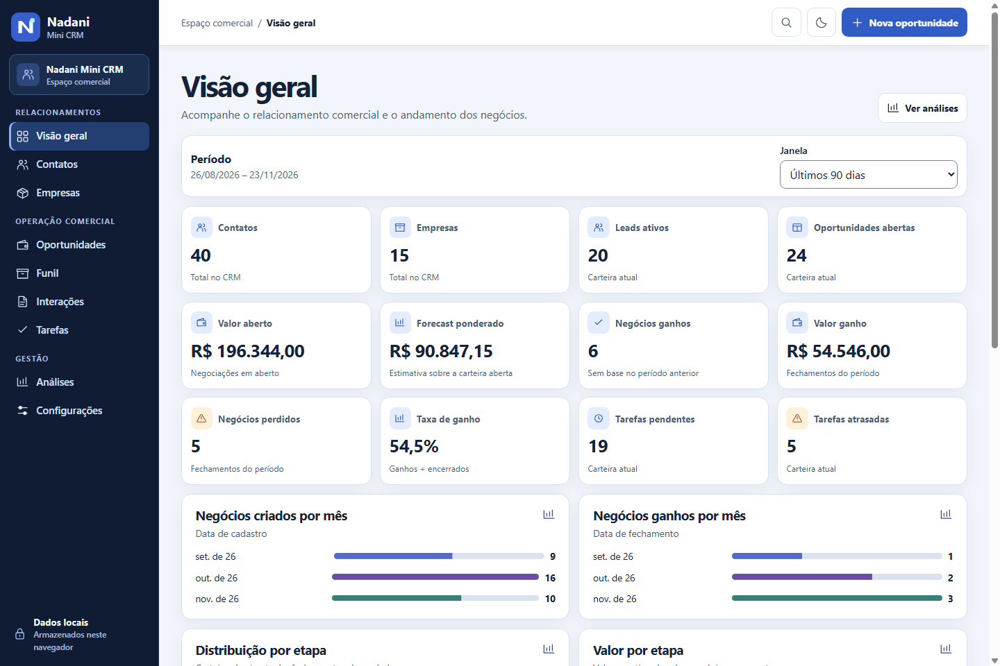

# Nadani Mini CRM

CRM comercial local para organizar contatos e empresas, acompanhar oportunidades e planejar o próximo contato com cada cliente. Projeto demonstrativo do portfólio da Nadani Productions para apresentar fluxos de gestão comercial em aplicações web.



[Funil comercial](docs/screenshots/funil.png) · [Interface mobile em tema escuro](docs/screenshots/mobile.png)

## O que o CRM oferece

| Área | Recursos |
| --- | --- |
| Relacionamentos | Contatos e empresas com vínculos, etiquetas, filtros, histórico, arquivamento e detecção de possíveis duplicatas. |
| Oportunidades | Lista comercial e funil Kanban configurável, com reordenação, fechamento, motivo de perda, reabertura e duplicação. |
| Acompanhamento | Registro manual de interações, tarefas com prioridades, alertas de atraso e calendário em mês, semana e agenda. |
| Indicadores | Carteira atual, previsão ponderada, resultados por período e gráficos de etapas, origens e tipos de interação. |
| Dados | Importação de contatos por CSV, exportação das cinco entidades em CSV e restauração de backup completo em JSON. |
| Interface | Tema claro, escuro ou do sistema, pesquisa global, atalhos de teclado, modais nativos e navegação responsiva. |

## Executar localmente

Use **Node.js 22 ou superior**, npm e um navegador atualizado. Na pasta do projeto, execute:

```bash
npm start
```

Abra [http://127.0.0.1:4178/nadani-mini-crm/](http://127.0.0.1:4178/nadani-mini-crm/). O servidor local entrega os arquivos estáticos e os módulos ES sem etapa de compilação. Os arquivos de execução estão em `index.html`, `css/`, `js/`, `assets/` e `vendor/`, com caminhos relativos para uso em um subdiretório.

## Primeiro uso

1. Escolha **Começar vazio** ou **Carregar demonstração**. A base fictícia contém 15 empresas, 40 contatos, 35 oportunidades, 80 interações e 25 tarefas.
2. Cadastre uma empresa e associe um contato. Em **Contatos**, abra os detalhes para revisar possíveis duplicatas, vínculos e histórico.
3. Crie uma oportunidade com um contato, um valor em BRL e uma etapa. Informe uma probabilidade própria ou use a da etapa.
4. No **Funil**, arraste o cartão pela alça com mouse ou toque. Para usar o teclado, abra os detalhes do cartão e use **Mover para etapa**, **Subir** ou **Descer**.
5. Registre uma ligação, reunião ou outra interação pelos detalhes do contato ou da oportunidade. Crie uma tarefa de retorno e acompanhe-a em **Tarefas** ou no **Calendário**.
6. Use **Ctrl+K** ou **⌘+K** para pesquisar contatos, empresas, oportunidades e tarefas. **Esc** fecha os modais.

### Regras de relacionamento

- Em contatos, a busca por duplicatas compara e-mail, telefone e nome com empresa. A mesclagem mostra uma prévia e pede confirmação. Os campos preenchidos do registro principal prevalecem, e os negócios, as tarefas, as interações e os eventos vinculados são transferidos.
- Exclua um registro quando não houver dependências. Contatos, empresas e oportunidades com dependências podem ser arquivados para preservar vínculos.
- **Ganho** e **Perdido** registram a data de fechamento. A perda aceita um motivo opcional. Reabrir devolve o negócio a uma etapa aberta e mantém as transições registradas no histórico.
- As etapas abertas podem ser criadas, editadas e reordenadas. Para excluir uma etapa ocupada, escolha outra etapa aberta para receber os cartões.
- O calendário trabalha com datas locais no formato `AAAA-MM-DD`. Os acompanhamentos identificam tarefas abertas ou vencidas e negócios sem interação pelo número de dias definido em **Configurações**.

### Como ler os indicadores

| Indicador | Cálculo |
| --- | --- |
| Carteira aberta | Negócios ainda em negociação, excluindo arquivados. Os cartões identificados como carteira atual usam o estado atual da base. |
| Previsão ponderada | Soma do valor estimado de cada negócio aberto multiplicado por sua probabilidade. O valor é calculado e arredondado em centavos por oportunidade. |
| Taxa de ganho | Ganhos ÷ (ganhos + perdidos) × 100, pela data de fechamento. Sem resultados no período, o painel exibe um estado informativo. |
| Valor médio e prazo de fechamento | Média do valor e do intervalo entre criação e fechamento dos negócios ganhos no período. |
| Comparação | Os indicadores com comparação consideram a janela anterior de mesma duração. A variação percentual aparece quando há base positiva no período anterior. |

A previsão expressa uma estimativa matemática. As séries de cadastro e fechamento usam suas respectivas datas. O fechamento reaberto deixa de contar como resultado atual, e o evento anterior permanece na timeline.

## Importação, exportação e backup

Em **Configurações**, importe um CSV UTF-8 de contatos, mapeie o cabeçalho de origem para cada campo e confira a prévia. O arquivo pode usar vírgula, ponto e vírgula ou tabulação. São aceitos até 2 MiB e 1.500 linhas de dados. Registros inválidos e possíveis duplicatas são separados na prévia e ignorados após a confirmação.

As exportações CSV incluem cabeçalho, aspas e proteção contra fórmulas em campos de texto. Valores de oportunidades saem em centavos e a moeda em coluna própria. Use o **backup JSON** para copiar a base completa, incluindo preferências, etapas e histórico.

A restauração valida a versão, o tamanho até 24 MiB, os identificadores e os vínculos antes de exibir a prévia. A confirmação substitui a base local. Se a leitura detectar um estado incompatível, **Configurações** permite baixar a cópia original e restaurar um backup válido.

## Arquitetura

- **Interface** em HTML semântico, CSS Grid, Flexbox, SVG e JavaScript com módulos ES. Rotas por fragmento, controles nativos e pesquisa com debounce.
- **Regras de domínio** em `js/model.js`, `js/business.js` e `js/analytics.js`, independentes do DOM.
- **Persistência** em IndexedDB, com snapshot versionado, validação e gravações transacionais. A revisão impede a substituição de uma base que mudou após a prévia. Edições verificam a última atualização do registro e abas da mesma origem recebem uma notificação de mudança.
- **Transferência** em `js/backup.js` e `js/transfer.js`. Papa Parse 5.7.1 é distribuído localmente para leitura e escrita de CSV, incluindo campos com aspas, separadores e quebras de linha.

```text
nadani-mini-crm/
├── index.html
├── assets/              Marca e ícones SVG
├── css/                 Temas, layout e componentes
├── js/                  Interface, domínio, relatórios e armazenamento
├── vendor/              Parser CSV e licença
├── tools/               Servidor HTTP para desenvolvimento e testes
├── tests/               Testes de unidade e cenários em Chromium
├── docs/screenshots/   Capturas reais com dados fictícios
├── README.md
└── LICENSE
```

Personalize a identidade visual nas variáveis de `css/main.css` e na marca em `assets/brand.svg`. As etapas iniciais, origens sugeridas, estados e limites ficam em `js/model.js`. As etapas e o nome do espaço também podem ser alterados pela interface.

## Testes

```bash
npm test
npm run test:browser
npm run test:browser -- --screenshots
```

A suíte usa `node:test`. A suíte de navegador usa Chromium via Chrome DevTools Protocol. Caso Chrome, Edge ou Chromium estejam em um caminho diferente, defina `BROWSER_PATH` com o caminho do executável. O teste abre um perfil temporário com uma base isolada.

## Privacidade e limitações

Este projeto é uma demonstração de portfólio. A base fica vinculada à origem, ao perfil e ao navegador em uso. O histórico local mantém os 700 eventos mais recentes. A lista de interações tem paginação e a timeline geral apresenta até 100 registros recentes.

O CRM opera sem autenticação, criptografia de dados em repouso, sincronização entre dispositivos ou lembretes com o navegador fechado. As ações de contato abrem o aplicativo ou site correspondente quando acionadas. Os registros de interação são inseridos manualmente. Use dados fictícios em demonstrações e guarde os backups localmente.

## Licença e crédito

MIT. A licença do parser CSV está em [vendor/PAPAPARSE-LICENSE](vendor/PAPAPARSE-LICENSE).

[Developed by Nadani Productions](https://nadani.space)

### About do repositório

> Professional CRM application built with JavaScript, featuring contact management, sales pipelines, deal tracking, follow-up tasks and interactive analytics.
